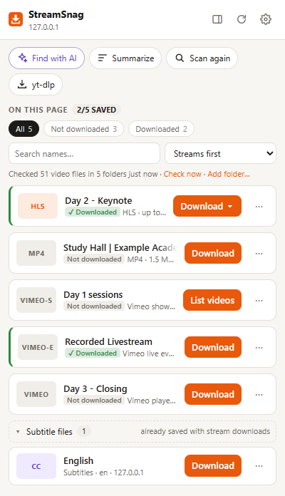

# StreamSnag

**A free, open-source video download helper for Chrome, Edge and Brave.** It finds the videos, audio,
streams and subtitles a page plays and saves them with one click. It also knows which ones you already have
and can grab a whole course playlist, skipping the lectures you've saved. It's an alternative to paid
download helpers, with optional AI (Claude) for sites that hide their videos.

[](https://github.com/cspergel/streamsnag/actions/workflows/ci.yml)
· MIT license · no tracking, no accounts ([privacy](PRIVACY.md))

> StreamSnag refuses DRM-protected and encrypted streams, and is meant for videos you have the right to keep.

<p align="center"></p>

## Quick start

1. **Get the code:** download the ZIP from the green **Code** button on GitHub (or `git clone`) and unzip it.
2. **Add the extension:** open `chrome://extensions` (or `edge://extensions`), turn on **Developer mode**,
   click **Load unpacked**, and choose the `extension` folder.
3. **Optional but recommended: the local helper.** It merges video and audio into one MP4 (ffmpeg),
   downloads playlists and hard sites (yt-dlp), checks your folders for videos you already have, and lets
   you save anywhere on your PC.
   * Windows: right-click `setup-windows.ps1` → **Run with PowerShell** (or
     `powershell -ExecutionPolicy Bypass -File .\setup-windows.ps1`). It checks for Node.js and offers to
     install ffmpeg and yt-dlp with winget.
   * macOS / Linux: `sh setup.sh`.
   * Then restart the browser and open StreamSnag **Settings → Local helper → Check helper**.

Open a page, press play (many players only load the video once it plays), and click the StreamSnag icon.

## What it does

### Finds the video
* **Watches what the page loads**: MP4/WebM/MP3 files, HLS (`.m3u8`) and DASH (`.mpd`) streams, and
  subtitles. It skips segments, tiny files and duplicates, and the badge shows the count.
* **Embedded players** (Vimeo, Wistia, YouTube, Loom and others), even inside tabs or accordions you never
  opened. Vimeo and Wistia are resolved to their real stream and title.
* **Playlists and Vimeo showcases**: **List videos** shows every video in the playlist with its number
  and title, not just the ones you played.
* **Scan again** re-checks every frame and web component without reloading the page, and the page is
  re-checked on its own every few seconds.
* **Find with AI** (optional) reads the page's network log and player code to find links plain sniffing
  misses, and writes a reusable **site recipe** so the site works without AI next time.

### Downloads it properly
* **Streams**: picks a quality, downloads segments in parallel with retries, records live HLS, and handles
  separate audio and subtitle tracks.
* **One finished file**: with the helper, video, audio and subtitles become one MP4 with soft subtitles,
  in seconds (no re-encoding).
* **Queue**: set how many downloads run at once; **Retry** a failed one with fresh links.
* **Good file names**: named after the lecture or episode, not the site's tab title. Use templates with
  `{title}`, `{number}`, `{name}`, `{course}`, `{date}`…, add **rules per site** (e.g.
  `Courses/{course}/{number} - {name}`), or **⋯ → Rename**.
* **Save anywhere** on your PC, in nested folders like `StreamSnag/{site}`.
* **yt-dlp fallback** for the 1000+ sites it supports, with **Update yt-dlp** in Settings.

### Knows what you already have
* Checks your folders and marks each video **✓ Downloaded** or **Not downloaded**, even after you rename
  files. It matches by the exact saved file, the video's permanent ID, its size or length, or its name
  (lecture number plus distinctive words). A file whose name says it's a different lecture never counts.
* **Download missing (N)** on a playlist fetches only the videos you don't have.
* **Mark as downloaded / not downloaded** fixes any wrong guess, **Add folder…** includes more folders,
  and the sidebar lists everything in your folders, searchable.

### Stays organised
* Search, sort (name, length, not-downloaded first…) or group by the page's tabs. Subtitle files are tucked
  into one group.
* Duplicate links to the same video (re-signed CDN links, redirects, mirrors) are shown once.
* The **sidebar** stays open, follows your tab, and shows details and your download history.
* **Backup & restore** your settings, recipes, rules, history and marks.

### AI features (optional, off by default)
* **Find with AI** and **site recipes** (above), **Ask AI why** for a failed download, **Summarize** a video
  from its captions, and tidy **AI file names**.
* Runs through **your Claude subscription** (via the Claude Code CLI on your PC, no API billing) or an
  **Anthropic API key**. See [PRIVACY.md](PRIVACY.md) for exactly what is sent.

## Limits

* **No DRM or encrypted streams.** Widevine/PlayReady/FairPlay and HLS with `EXT-X-KEY` are detected and refused.
* Very long 4K streams are better downloaded with yt-dlp; live DASH needs yt-dlp.
* Some sites restrict their players to their own pages; playlist listing and yt-dlp downloads pass the page as
  Referer, which works for many but not all.
* It's distributed through GitHub, not the Chrome Web Store (whose policies don't allow some of what it does).

## Privacy

No servers, analytics or tracking. Everything stays on your computer except the downloads themselves and the
AI requests you choose to make. Details and the reason for each permission: [PRIVACY.md](PRIVACY.md).

## Develop

```sh
npm install        # dev tools: tests, SDK bundler
npm test           # unit tests (parsers, detection, matching, recipes, helper protocol, real ffmpeg merge)
node scripts/e2e.js   # loads the extension in headless Chrome against a local test site (60+ checks)
```

```
extension/         MV3 extension (no build step)
  background.js    service worker: detection, per-tab state, queue, jobs, AI, helper
  content.js       page scan (frames, shadow DOM), video names, snapshots for recipes/AI
  offscreen.js     joins stream segments into one file
  popup.* options.* sidepanel.*   UI
  lib/             detect, hls, dash, match (library), recipes, ai, util…
  vendor/          bundled @anthropic-ai/sdk (npm run build)
native-host/       local helper (Node, no dependencies): ffmpeg, yt-dlp, Claude CLI, folders
scripts/           e2e.js, build-sdk.js, make-icons.js
tests/             node:test unit tests
```

See [CONTRIBUTING.md](CONTRIBUTING.md) for guidelines and good first projects (translations, Firefox),
[SECURITY.md](SECURITY.md) to report a vulnerability, and [CHANGELOG.md](CHANGELOG.md) for what's new.

## License

[MIT](LICENSE). Not affiliated with any other download helper, video platform, or Anthropic.
